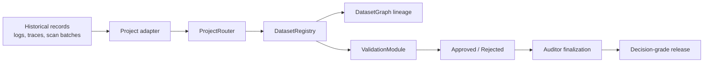

# DatumX

DatumX is a smart-contract protocol and operator console for verifying the integrity of AI-transformed industrial datasets. It is built around a narrow thesis: in mineral exploration and similar industrial workflows, the bottleneck is no longer extracting data from legacy records, but proving that transformed data can be trusted after AI, computer vision, normalization, interpretation, and validation steps have altered it.

DatumX treats a dataset release as a governed analytical unit. Each release carries lineage, validation state, approval counts, confidence metrics, and a finalization outcome before it is treated as decision-grade. The repo combines that protocol layer with the DatumX **Resource Integrity Console**, a React application designed to surface provenance, validation posture, and lineage in a form technical users can actually inspect.

DatumX Protocol · Built by ZRT — [https://github.com/zrt219](https://github.com/zrt219)

## Why DatumX Exists

Industrial data pipelines increasingly depend on AI-assisted transformation. Historical drill logs, scanned gamma traces, and analog field records can now be digitized and normalized at a speed that was previously unavailable. The harder problem is no longer raw extraction. The harder problem is deciding whether the transformed output is trustworthy enough to drive technical and capital decisions.

Traditional storage systems preserve files. They do not necessarily preserve the decision context of transformation. They do not enforce stage progression. They do not require validators to declare approval or rejection. They do not prevent ambiguous branching of analytical lineage. They do not distinguish between a package that merely exists and a package that has satisfied a defined release threshold.

DatumX addresses that gap with five core ideas:

1. project-scoped adapter normalization
2. canonical dataset registration
3. deterministic lineage rules
4. validator-only review with threshold aggregation
5. auditor-gated finalization

## Repository Guide

```text
contracts/
  adapters/       Project-specific normalization logic
  core/           Protocol registry, routing, lineage, and validation
  interfaces/     Shared protocol types and interfaces
  libraries/      Errors, events, hashing, project keys
test/             Foundry protocol tests
script/           Deployment and XRPL smoke-test automation
deployments/      Canonical XRPL deployment manifest and operational logs
src/              React + TypeScript Resource Integrity Console
docs/             Long-form protocol documentation and case study
```

## Architecture Overview



DatumX deliberately separates concerns:

- **Adapters** normalize project-specific submissions into a canonical payload.
- **ProjectRouter** is the single submission entry point and enforces adapter resolution.
- **DatasetRegistry** stores canonical release metadata and dataset status.
- **DatasetGraph** enforces deterministic parent-child lineage.
- **ValidationModule** handles review submission, aggregation, threshold logic, and finalization eligibility.
- **ProjectRegistry** binds project keys to project metadata and adapters.

## Core Protocol Components

### `ProjectRegistry`

Registers active projects and their adapters. Project keys are part of the protocol trust boundary, so adapter bindings are validated against the adapter’s declared `expectedProjectKey`.

### `ProjectRouter`

Accepts project-keyed submissions, resolves the correct adapter, and routes only normalized canonical payloads into the registry. Components do not write datasets directly.

### `DatasetRegistry`

Stores the canonical dataset record, blocks duplicate content hashes, enforces project activity, and applies deterministic lineage rules:

- parent must exist
- parent must belong to the same project
- parent must already be finalized
- lineage cannot branch
- child stage must be the exact next stage

### `DatasetGraph`

Maintains parent-child references and ancestry queries. This is intentionally simple and deterministic rather than attempting generalized graph flexibility.

### `ValidationModule`

Accepts validator reviews, enforces one-review-per-validator, aggregates approval and rejection counts, computes aggregate confidence, and determines whether a dataset is approved or rejected. Finalization remains a separate auditor action.

## Adapter Model

Adapters are the protocol’s normalization layer, not a cosmetic plugin system. A project submission reaches the core contracts only after the assigned adapter has validated payload shape, enforced project-specific submission rules, and emitted a canonical dataset input.

Included adapters:

- `DuckCreekAdapter`
- `ShirleyCentralAdapter`
- `ShirleyEastAdapter`

The protocol’s current typed submission boundary is `AdapterPayload`, which includes:

- dataset type
- schema version
- record count
- claimed confidence
- source hash
- transform hash
- submission ID

This typed payload is central to V5 because it reduces ambiguity between project-specific ingestion and protocol-level canonical registration.

## Deterministic Lineage Rules

DatumX does not treat lineage as a free-form tree. It treats lineage as a controlled release progression.

Current V5 rules:

- root packages start with no parent
- children must reference an existing parent dataset hash
- the parent must already be finalized
- the child must remain inside the same project
- the child stage must be exactly one stage ahead of the parent
- a finalized parent can have only one child

That “no-branch” rule is intentional. DatumX is optimizing for defensible release history, not for arbitrary exploratory branching inside the protocol core.

## Validation and Finalization Model

DatumX separates review from release closure.

- **Validators** can submit reviews
- **Auditors** can finalize datasets once protocol thresholds are satisfied

This produces cleaner role separation:

- validators judge the release
- auditors close the release
- admins manage thresholds and registry configuration

The current validation thresholds on XRPL EVM testnet are:

- minimum validator count: `3`
- minimum approval ratio: `6667` bps
- minimum confidence: `7000` bps

## Resource Integrity Console

The frontend is a React + TypeScript console built to surface protocol truth rather than hide it. It is intentionally dark, dense, and operational rather than consumer-oriented. The UI prioritizes:

- lineage visibility
- validation transparency
- audit timeline clarity
- MetaMask connectivity
- XRPL explorer linking
- mock/live boundary discipline

Live chain reads currently feed:

- project metadata
- dataset registry state
- reviewer data
- thresholds
- lineage relations

The UI preserves enriched mock narrative data only where the contracts do not expose prose-level metadata.

## XRPL EVM Testnet

DatumX is configured for XRPL EVM Testnet:

- network name: `XRPL EVM Testnet`
- chain ID: `1449000`
- RPC: `https://rpc.testnet.xrplevm.org/`
- explorer: `https://explorer.testnet.xrplevm.org`
- native token: `XRP`

MetaMask flow:

1. connect wallet
2. detect active chain
3. add or switch to XRPL EVM Testnet if needed
4. submit or review through typed contract clients
5. inspect receipts on the XRPL explorer

## Deployment Records

Canonical deployment and verification records live here:

- [XRPL deployment manifest](C:\Users\Zhane\Documents\New%20project\DatumX\deployments\xrpl-testnet.json)
- [XRPL deployment log](C:\Users\Zhane\Documents\New%20project\DatumX\deployments\xrpl-testnet.md)
- [XRPL verification notes](C:\Users\Zhane\Documents\New%20project\DatumX\deployments\xrpl-testnet-verification.md)
- [XRPL smoke-test script](C:\Users\Zhane\Documents\New%20project\DatumX\script\xrpl-smoke-test.ps1)

The canonical V5 deployment already includes:

- a live root→child lineage proof
- a later admin fast-path smoke exercise
- restored thresholds after temporary reduction for single-validator smoke verification

## Long-Form Case Study

The full protocol case study lives here:

- [DatumX case study](C:\Users\Zhane\Documents\New%20project\DatumX\docs\datumx-case-study.md)

It expands on:

- why DatumX exists
- why raw storage is the wrong framing
- the adapter/router/registry/validation architecture
- the V4/V5 protocol correction
- deterministic lineage rules
- validator/auditor role separation
- XRPL EVM deployment realities
- live root→child proof on XRPL

## Local Setup

Install dependencies:

```bash
npm install
```

Run the console locally:

```bash
npm run dev
```

## Verification Commands

Frontend lint:

```bash
npm run lint
```

Frontend tests:

```bash
npm run test
```

Production build:

```bash
npm run build
```

Contracts compile:

```bash
npm run contracts:build
```

Contracts test:

```bash
npm run contracts:test
```

Full local verification:

```bash
npm run verify
```

XRPL smoke flow:

```bash
npm run contracts:smoke:xrpl
```

## XRPL Smoke-Test Requirements

Create a local environment file from the example:

```bash
copy .env.example .env
```

Set:

```bash
PRIVATE_KEY=0xYOUR_DEPLOYER_PRIVATE_KEY
```

The XRPL smoke runner is designed for XRPL EVM behavior:

- fixed gas limits
- legacy gas mode
- explicit transaction-hash logging
- no dependency on `eth_estimateGas`

## Frontend Configuration Points

If a live deployment changes, update only the centralized configuration layer:

- [web3Config.ts](C:\Users\Zhane\Documents\New%20project\DatumX\src\lib\web3Config.ts)
- [contracts.ts](C:\Users\Zhane\Documents\New%20project\DatumX\src\lib\contracts.ts)
- [drillProofClient.ts](C:\Users\Zhane\Documents\New%20project\DatumX\src\lib\drillProofClient.ts)
- [liveProtocol.ts](C:\Users\Zhane\Documents\New%20project\DatumX\src\lib\liveProtocol.ts)

Do not spread addresses or ABI assumptions into components.

## Screenshots

Reserved showcase captures:

- `docs/screenshots/overview.png`
- `docs/screenshots/datasets.png`
- `docs/screenshots/validation.png`
- `docs/screenshots/audit-trail.png`
- `docs/screenshots/governance.png`

## Roadmap

- regenerate V5 standard-json verification artifacts for explorer verification
- extend adapter coverage to additional exploration programs
- add richer release artifacts and review attachments
- formalize governance and reputation-weighted validator evolution
- add Merkle-style drill-level proof strategies for higher-granularity verification

## License

MIT
