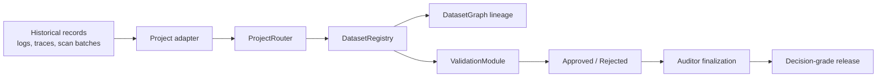
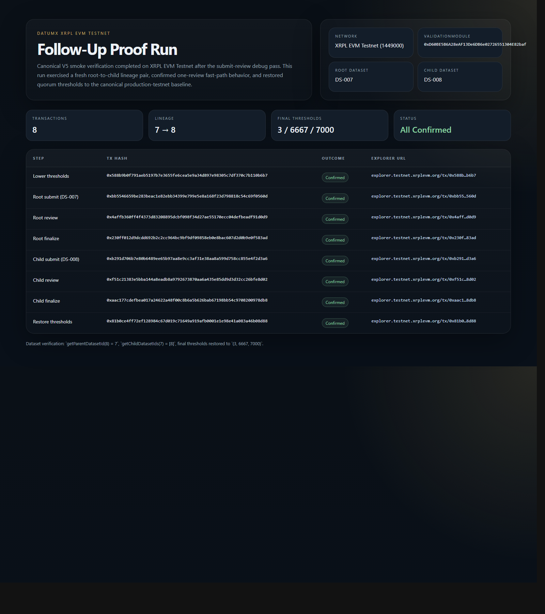

# DatumX

 -blue) -black)   

DatumX is a Solidity protocol and **Resource Integrity Console** for proving that AI-transformed industrial datasets are release-grade. It treats every dataset release as a governed analytical unit with canonical payloads, deterministic lineage, validator consensus, and auditor-controlled finalization.

DatumX Protocol · Built by ZRT — https://github.com/zrt219

## War Diary (XRPL EVM Testnet)
- **2026-04-02 — V4.5 deploy (archived).** Intent: first full stack on XRPL EVM testnet. Change: shipped typed payloads with gaps. Outcome: replaced; addresses captured in `deployments/archive/xrpl-testnet-v4.json`.
- **2026-04-02 — V5 redeploy (canonical).** Intent: fix AdapterPayload typing boundary. Change: redeployed full stack. Outcome: canonical addresses in `deployments/xrpl-testnet.json`.
- **2026-04-03 — Admin fast-path smoke.** Intent: prove lineage and finalization under lowered quorum. Change: thresholds dropped to 1; lineage 3→4 exercised. Outcome: finalized; thresholds restored (lower `0x56b7797abcc95b022e5007dd47d7cc5576519d5073b962ed9c4899426caa433f`, restore `0x99a639b01dbd0ed81cceeb8eade9088fcde05ae50c40c16c29f157336a9148fa`).
- **2026-04-04 — Release-candidate fast-path smoke.** Intent: repeat fast-path with fresh IDs. Change: thresholds lowered; lineage 5→6 executed. Outcome: finalized; thresholds restored (lower `0x319f25e36aba86209ed361d5456f1d2a431be73baaaeff31fb8af054c2cb2744`, restore `0xa8bd9b575fa02d2f00abe902cfa6aa700d4fba08e26906815b41cb3d58713d5d`).
- **2026-04-18 — Follow-up XRPL proof run.** Intent: rerun the admin fast-path after submit-review debugging and preserve a fresh explorer-backed lineage proof. Change: thresholds lowered; lineage 7→8 executed end to end. Outcome: all 8 transactions succeeded; thresholds restored (lower `0x588b9b0f791aeb5197b7e3655fe6cea5e9a34d897e98305c7df370c7b110b6b7`, restore `0x81b0ce4ff72ef128984c67d019c71649a919afb0001e1e98e41a083a46b08d88`).
- **2026-04-04 — Explorer verification attempts.** Intent: verify all contracts on Blockscout. Change: bulk + single submissions accepted. Outcome: verification stuck in queue; details in `deployments/xrpl-testnet-verification.md`.

## Deployment Ledger
| Role | V5 Address / Tx | V4.5 Address | Deploy Count |
| --- | --- | --- | --- |
| Access / Roles (`DrillProofAccess`) | [0x47AA...c2e5](https://explorer.testnet.xrplevm.org/address/0x47AA8f1F35DB309Be2bd7aD1b58070092A7dc2e5) (tx [0xfc5f...4924](https://explorer.testnet.xrplevm.org/tx/0xfc5fdf85209bfd92a4247cfa700ca6ba990a5174ac6f1f671868b22352d04924)) | [0x137d...c7af](https://explorer.testnet.xrplevm.org/address/0x137d48dc29dab3d9debeba4522daca08db66c7af) | 2 |
| Project registry (`ProjectRegistry`) | [0x238f...6687](https://explorer.testnet.xrplevm.org/address/0x238fc107Dc66A08B93A28107399dCC35968d6687) (tx [0x6ffc...bbd3](https://explorer.testnet.xrplevm.org/tx/0x6ffc3bf4682ad8bb02d36c502cb2359a436e5bfe2ce478c1b898eeec57d9bbd3)) | [0x6c11...1f1](https://explorer.testnet.xrplevm.org/address/0x6c11f63c7da3aded68f3c526bad3313c966fb1f1) | 2 |
| Dataset registry (`DatasetRegistry`) | [0x0Fa0...5e0B](https://explorer.testnet.xrplevm.org/address/0x0Fa0b1a4C21BB0cbF5DA4441570e9d997EAf5e0B) (tx [0x80a7...519a](https://explorer.testnet.xrplevm.org/tx/0x80a7c83e6f33541c63a8fad3d84036cd0094b8d689c3f83773c9fde69ad9519a)) | [0xeaef...fc98](https://explorer.testnet.xrplevm.org/address/0xeaef79fcba4dbaa5e695ace4d07843a03979fc98) | 2 |
| Validation (`ValidationModule`) | [0xD60B...baf](https://explorer.testnet.xrplevm.org/address/0xD60BE5B6A28eAF13De6DB6e02726551304E82baf) (tx [0xf09b...1d0be](https://explorer.testnet.xrplevm.org/tx/0xf09b52305ec406e9aa3201c71ce2ac5e3fe84e63aecb42643af081ebfbe1d0be)) | [0xc553...672f](https://explorer.testnet.xrplevm.org/address/0xc553f21cb6e3e0f612f60f408a636f2f58f6722f) | 2 |
| Router (`ProjectRouter`) | [0x04dC...1637](https://explorer.testnet.xrplevm.org/address/0x04dC258B2329114F5907fFD5c8600c72E5BA1637) (tx [0x1ebd...d620](https://explorer.testnet.xrplevm.org/tx/0x1ebd4414ae0c774473da3dbf314ab5eee29862419c46769755518a77883cd620)) | [0x7078...a2bb](https://explorer.testnet.xrplevm.org/address/0x70785c5d3dc81e3298c676b4f1bf0bb715ada2bb) | 2 |
| Adapter (`DuckCreekAdapter`) | [0x431B...0254](https://explorer.testnet.xrplevm.org/address/0x431B5d8b0D471e51Fff2fF2D05c784B527fc0254) (tx [0xf40c...b2ac](https://explorer.testnet.xrplevm.org/tx/0xf40c6f10edfec5be7df468ec90090b4ff95a2896568c5f5ffaa9decd1bd3b2ac)) | [0x72b4...f252](https://explorer.testnet.xrplevm.org/address/0x72b4f2dd926e33c6e784dc87a0c768fe080ff252) | 2 |
| Adapter (`ShirleyCentralAdapter`) | [0xD54e...6797](https://explorer.testnet.xrplevm.org/address/0xD54e7c8298934e850eBcF4aa2E541eFb821a6797) (tx [0x1490...fbca](https://explorer.testnet.xrplevm.org/tx/0x149046e84c163522d1c65a8ff81d0247683fba70fefe786f1413aac41f73fbca)) | [0x9ec2...ab27](https://explorer.testnet.xrplevm.org/address/0x9ec29f893695e6836389aa0f1d22302ef804ab27) | 2 |
| Adapter (`ShirleyEastAdapter`) | [0xCB04...b993](https://explorer.testnet.xrplevm.org/address/0xCB04fEE2D7F8555a9C9b2473442F81A4b64Db993) (tx [0xf129...b93eb](https://explorer.testnet.xrplevm.org/tx/0xf12905c2fc3be93d5f0c2bab090012128b2a5a9db0c105f53f62f01f5c5b93eb)) | [0xf27f...e580](https://explorer.testnet.xrplevm.org/address/0xf27fd39be462f2bfb7556ee06ec4dabdff54e580) | 2 |

_Manifests:_ V5 `deployments/xrpl-testnet.json`; archived V4.5 `deployments/archive/xrpl-testnet-v4.json`.

## Live Lineage Proofs (XRPL)
- 1→2 (SHIRLEY_CENTRAL): root `0xc38e6d451f302740bd8fa6398405ce11d162e7532f636b44927ecad94599a6e8`, finalize `0x57fdf994da619d999a5750b9469cb02b51ba6dcdae73d6a183ba483032cd6705`; child `0x8a8ab32b0b6b0621bdfcfadb395fc8fa2c9099c18333fa0b11532b0056ea8bdd`, finalize `0x57770356b9776a046415f32d7ed52d1d99eaa92cc02f6ac348b3c4595d8e5c0f`.
- 3→4 (admin fast-path): thresholds lower `0x56b7797abcc95b022e5007dd47d7cc5576519d5073b962ed9c4899426caa433f`; root `0x23241778cc15a87e4af6c17674e568fdd2d32f703746344e1743763dc65e8d8d`, finalize `0xbc668f21a9b0ae2c7653de25f2e3750d96d2c73e76b9d28fd40ec5a87749d20d`; child finalize `0x1360e79b394105c56daa82a56c1e07c7e938becd72e94efa6ca529572162be85`; thresholds restore `0x99a639b01dbd0ed81cceeb8eade9088fcde05ae50c40c16c29f157336a9148fa`.
- 5→6 (release-candidate): thresholds lower `0x319f25e36aba86209ed361d5456f1d2a431be73baaaeff31fb8af054c2cb2744`; root `0x5643c2e16114c7b833d9975e7fca353f79d7aa2b49bd50b5d4f249424ffb098f`, finalize `0xcada91ccf516fdce022ae3d4b7b3b3b84950115a3e0522f3fd16aeeb41509796`; child finalize `0x47b285551172bde367cbaf78839e891a8e6b5d4a32f09e55786af0ae2595742b`; thresholds restore `0xa8bd9b575fa02d2f00abe902cfa6aa700d4fba08e26906815b41cb3d58713d5d`.
- 7→8 (follow-up proof run): thresholds lower `0x588b9b0f791aeb5197b7e3655fe6cea5e9a34d897e98305c7df370c7b110b6b7`; root `0xbb5546659be283beac1e82ebb34399e799e5e8a168f23d798818c54c69f0560d`, finalize `0x230ff012d9dcdd692b2c2cc964bc9bf9df09858eb0e8bac607d2d0b9e0f583ad`; child finalize `0xaac177cdefbea017a24622a48f00c8b6a5b626bab67198bb54c9708200978db8`; thresholds restore `0x81b0ce4ff72ef128984c67d019c71649a919afb0001e1e98e41a083a46b08d88`.

## What This Repo Is
- Solidity protocol for trusted transformed datasets on XRPL EVM testnet.
- React/Vite **Resource Integrity Console** to inspect provenance, validation, lineage, and audit history.
- Deployment + smoke-test automation for XRPL EVM testnet, with logs and manifests checked in.

## Why DatumX Exists
Industrial data pipelines now hinge on transformed outputs (digitized logs, AI-parsed traces). Storage is not the problem; trust is. DatumX enforces canonical payloads, deterministic lineage, validator consensus, and auditor closure so transformed releases are defensible.

## Repository Guide
```text
contracts/       Solidity protocol (core, adapters, interfaces, libraries)
test/            Foundry protocol tests
script/          Deployment + XRPL smoke automation
deployments/     Manifests, logs, verification bundles
src/             React + TypeScript console (Resource Integrity Console)
docs/            Long-form protocol case study and screenshots
```

## Architecture Overview


- Adapters normalize project-specific submissions into a canonical payload.
- ProjectRouter is the single submission entry point.
- DatasetRegistry stores canonical release metadata and status.
- DatasetGraph enforces deterministic parent-child lineage.
- ValidationModule aggregates validator reviews and gates finalization.
- ProjectRegistry binds project keys to adapters.

## Adapter Model
Adapters are the normalization boundary. Each project has its own adapter; only canonical payloads reach the registry. Current typed payload: dataset type, schema version, record count, claimed confidence, source hash, transform hash, submission ID. Current adapters: DuckCreek, ShirleyCentral, ShirleyEast.

## Deterministic Lineage Rules
- Root packages start with no parent.
- Child must reference an existing finalized parent in the same project.
- Child stage must be exactly the next stage; no branching.
- Duplicate content hashes are rejected.

## Validation and Finalization Model
- Validators submit approval/rejection + confidence (one per validator per dataset).
- Threshold aggregation drives approved/rejected state.
- Auditors finalize only approved datasets that still meet thresholds.
- Current thresholds: minValidatorCount=3, minApprovalRatioBps=6667, minConfidenceBps=7000.

## Noble Pains Uranium Alignment
Noble Pains is digitizing legacy uranium drill programs where interpretation risk dominates extraction cost. DatumX matches that profile: adapters enforce canonical AI-transformed payloads, deterministic lineage locks root→child proofs, validators provide consensus confidence, and auditors control finalization. The result is decision-grade drill data that can withstand investor, regulator, and board scrutiny.

## Resource Integrity Console
React/Vite console for protocol truth: lineage, validation posture, audit timeline, MetaMask flow, XRPL explorer linking. Live reads stay centralized in `src/lib/liveProtocol.ts` and related config files.

## XRPL EVM Testnet Config
- network name: XRPL EVM Testnet
- chain ID: 1449000
- RPC: https://rpc.testnet.xrplevm.org/
- explorer: https://explorer.testnet.xrplevm.org
- native token: XRP

## Deployment Records
- Manifest: `deployments/xrpl-testnet.json`
- Deployment log: `deployments/xrpl-testnet.md`
- Verification notes: `deployments/xrpl-testnet-verification.md`
- Archived V4.5 manifest: `deployments/archive/xrpl-testnet-v4.json`
- Smoke runner: `script/xrpl-smoke-test.ps1`

## XRPL Proof Links
- Follow-up proof run checklist:
  - lower thresholds: [0x588b...b6b7](https://explorer.testnet.xrplevm.org/tx/0x588b9b0f791aeb5197b7e3655fe6cea5e9a34d897e98305c7df370c7b110b6b7)
  - root submit: [0xbb55...560d](https://explorer.testnet.xrplevm.org/tx/0xbb5546659be283beac1e82ebb34399e799e5e8a168f23d798818c54c69f0560d)
  - root review: [0x4aff...d0d9](https://explorer.testnet.xrplevm.org/tx/0x4affb360ff4f4373d83208895dcbf098f34d27ae55170ecc04defbeadf91d0d9)
  - root finalize: [0x230f...83ad](https://explorer.testnet.xrplevm.org/tx/0x230ff012d9dcdd692b2c2cc964bc9bf9df09858eb0e8bac607d2d0b9e0f583ad)
  - child submit: [0xb291...d3a6](https://explorer.testnet.xrplevm.org/tx/0xb291d706b7e80b6489ee65b97aa8e9cc3af31e38aa8a599d758cc855e4f2d3a6)
  - child review: [0xf51c...8d02](https://explorer.testnet.xrplevm.org/tx/0xf51c21383e5bba144a8eadb8a9792673870aa6a435e85dd9d3d32cc26bfe8d02)
  - child finalize: [0xaac1...8db8](https://explorer.testnet.xrplevm.org/tx/0xaac177cdefbea017a24622a48f00c8b6a5b626bab67198bb54c9708200978db8)
  - restore thresholds: [0x81b0...8d88](https://explorer.testnet.xrplevm.org/tx/0x81b0ce4ff72ef128984c67d019c71649a919afb0001e1e98e41a083a46b08d88)

## Screenshots
- Follow-up proof board: `docs/screenshots/xrpl-followup-proof-board.png`
- Source file for regeneration: `docs/screenshots/xrpl-followup-proof.html`



## Long-Form Case Study
`docs/datumx-case-study.md`

## Local Setup
```bash
npm install
npm run dev
```

## Verification Commands
```bash
npm run lint
npm run test
npm run build
npm run contracts:build
npm run contracts:test
npm run verify
npm run contracts:smoke:xrpl
```

## Badges Legend
- All badges are static Shields metadata (no CI status yet).
- Network/status badges reflect the current XRPL EVM testnet V5 deployment.

## Author's Note
Built and narrated by ZRT (Smart Contract Engineer · Blockchain Systems Engineer · Web3 Infrastructure Engineer). Solidity discipline here is not aesthetics—it is how we guarantee operational integrity: typed payloads, no-branch lineage, validator-only reviews, auditor-only finalization, and explicit XRPL constraints (legacy gas, no `eth_estimateGas`) wired into tooling. This repository is meant to be audited, attacked, and trusted in equal measure.

## License
MIT
