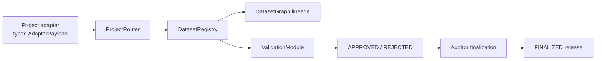

# DatumX


> Deterministic release-governance protocol for AI-transformed industrial datasets, with canonical payload enforcement, no-branch lineage, validator consensus, and auditor-controlled finalization on XRPL EVM Testnet.

 -5F7FA7) -1f2937)    -38bdf8)

## Branch Status: BOT Chain Registry Pilot (`feature/botchain-registry-pilot`)

This branch contains the isolated **BOT Chain Dataset Registry Pilot** prepared for technical review with **Leon, Roy, and Josh** from BOT Chain. It establishes an independent multi-network architecture supporting both the canonical **XRPL EVM Testnet (1449000)** and **BOT / Bohr Testnet (968)**.

> Full Technical Dossier: See [`BOTCHAIN_PILOT_SUMMARY.md`](BOTCHAIN_PILOT_SUMMARY.md) and [`docs/botchain/FRIDAY_HANDOFF.md`](docs/botchain/FRIDAY_HANDOFF.md) for research notes, test benchmarks, and review discussion points.

### Summary of Completed Deliverables:
- **Smart Contract ([`contracts/botchain/BotChainDatasetRegistry.sol`](contracts/botchain/BotChainDatasetRegistry.sol))**: Lightweight dataset registry storing cryptographic proofs (`SHA-256`), versions, and public metadata references (`registerDataset`, `getDataset`, `verifyDatasetHash`).
- **Foundry Deployment Automation ([`script/DeployBotChainRegistry.s.sol`](script/DeployBotChainRegistry.s.sol))**: Deterministic deployment script targeting Bohr Testnet (`Chain ID 968`).
- **Two-Network Frontend Architecture**:
  - Independent network definitions ([`src/lib/botchainConfig.ts`](src/lib/botchainConfig.ts)) targeting Bohr Testnet (`https://rpc.bohr.life`, `https://scan.bohr.life`).
  - Canonical JSON serialization and SHA-256 calculation ([`src/lib/canonicalHash.ts`](src/lib/canonicalHash.ts)).
  - Interactive **BOT Chain Pilot** console view ([`src/components/botchain/BotChainPilotPanel.tsx`](src/components/botchain/BotChainPilotPanel.tsx)) providing the 3-step **Register -> Read -> Verify** workflow with instant match/mismatch verification.
- **Verification & Stress Testing**:
  - **100x Stress Test Passed**: 100 consecutive runs across Foundry (4,200 tests), Vitest (1,700 tests), and Playwright headless browser (1,300 UI steps) with 100% pass rate and zero flakes.
  - **3 Multi-Layer Smoke Tests Passed**: Verified via multi-agent teamwork and confirmed by clean-room independent Victory Audit.
- **Zero Regression**: Preserves all existing XRPL EVM Testnet contracts, deployment manifests ([`deployments/xrpl-testnet.json`](deployments/xrpl-testnet.json)), and tests without modification.

---

## Live Demo

| Surface | Link |
| --- | --- |
| Dashboard | [datumx.vercel.app](https://datumx.vercel.app) |
| ValidationModule | [0xD60B...2baf](https://explorer.testnet.xrplevm.org/address/0xD60BE5B6A28eAF13De6DB6e02726551304E82baf) |
| ProjectRouter | [0x04dC...1637](https://explorer.testnet.xrplevm.org/address/0x04dC258B2329114F5907fFD5c8600c72E5BA1637) |
| Network | XRPL EVM Testnet (`1449000`) |

DatumX is live on XRPL EVM Testnet with a canonical V5 deployment, recorded lineage proofs for `1->2`, `3->4`, `5->6`, and `7->8`, and threshold restoration back to `3 / 6667 / 7000` after every fast-path smoke exercise.


---
## What This Is

DatumX is a Solidity protocol and inspection console for proving that AI-transformed exploration datasets are decision-grade before they move into technical review, targeting, and resource-definition workflows. It does not treat transformed data as a file-storage problem. It treats each release as a governed analytical unit with a canonical payload, explicit lifecycle, deterministic lineage, validator review state, confidence aggregation, and auditor-controlled closure.

The protocol is built around a strict submission boundary. Project-specific adapters normalize typed payloads into canonical dataset inputs. The router is the single submission entry point. The registry records the release and blocks duplicate hashes. The lineage graph enforces finalized-parent progression with no branching. The validation module accepts validator-only reviews, computes approval/confidence thresholds, and only permits auditor finalization once the dataset is actually eligible.

DatumX is also intentionally honest about trust boundaries. There is no hidden backend adjudicating release legitimacy, no off-chain relay pretending to be canonical truth, and no UI state that outranks the chain. The React/Vite console exists to inspect protocol posture, lineage, validation state, and XRPL evidence, not to invent release status that the contracts did not produce.

## Features

### Blockchain

- Canonical dataset registration through `ProjectRouter.submitDataset(...)` and `DatasetRegistry.submitCanonicalDataset(...)`

- Typed `AdapterPayload` normalization with project-key binding checks and deterministic content hashing

- Duplicate dataset rejection by canonical content hash

- Finalized-parent lineage enforcement with exact-next-stage progression and explicit no-branch constraints

- Validator-only review submission through `ValidationModule.submitReview(...)`

- Auditor-only finalization through `ValidationModule.finalizeDataset(...)`

- Threshold-controlled approval using `minValidatorCount`, `minApprovalRatioBps`, and `minConfidenceBps`

- Full XRPL EVM deployment manifest with contract addresses, deploy tx hashes, post-deploy role grants, and explorer proof links

### Dashboard

- Resource Integrity Console built in React/Vite with live MetaMask network detection and XRPL explorer linking

- Lineage-first inspection surfaces that show release progression instead of isolated dataset cards

- Validation views aligned to protocol truth: approvals, rejections, aggregate confidence, thresholds, and finalization posture

- Audit timeline and proof-board presentation tied to recorded XRPL transactions

- Mock-enriched presentation that stays explicitly bounded by live protocol reads and deployment manifests

- Premium technical UI language tuned for industrial review rather than speculative token dashboard aesthetics

## War Diary

| Date | Intent | Technical Change | Outcome |
| --- | --- | --- | --- |
| 2026-04-02 | Establish first full DatumX deployment on XRPL EVM testnet | V4.5 deploy completed but left the protocol with a weaker adapter boundary and less disciplined lineage semantics | Archived as superseded in `deployments/archive/xrpl-testnet-v4.json` |
| 2026-04-02 | Correct the submission boundary | V5 redeployed the full graph around typed `AdapterPayload`, cleaner adapter normalization, and stricter release semantics | Canonical deployment recorded in `deployments/xrpl-testnet.json` |
| 2026-04-03 | Prove fast-path lineage on live XRPL | Thresholds lowered to `1 / 6667 / 7000`, root `3` and child `4` submitted/finalized, then thresholds restored | First admin fast-path lineage proof completed and restored to `3 / 6667 / 7000` |
| 2026-04-04 | Re-run against the release-candidate posture | Fresh root `5` and child `6` exercised end to end on the same V5 contracts | Second XRPL lineage proof completed with restored thresholds |
| 2026-04-04 | Verify contracts on Blockscout | Standard JSON bundles submitted in bulk, then retried one-by-one for selected contracts | Submissions accepted but verification remained stuck in the explorer queue |
| 2026-04-17 | Debug failing `submitReview` execution | Added simulation, custom-error decoding, and structured preflight checks to reveal `ReviewAlreadySubmitted()` on finalized `DS-006` | Review writes now fail loudly before broadcast with the real reason |
| 2026-04-18 | Preserve a fresh explorer-backed lineage proof after the review-debug pass | Fast-path smoke run created datasets `7` and `8`, verified `getParentDatasetId(8) = 7`, then restored thresholds | Third recorded fast-path lineage proof completed successfully |

---

## ⚡ Live Execution

### Governance & Threshold Controls


### Workflow Design & Research


### Overview Dashboard


### Validation Queue
https://github.com/user-attachments/assets/ba2fd327-4c84-406e-b942-6e3d9ffd4306

### Audit Trail
https://github.com/user-attachments/assets/cc6dfa2b-7ed4-415c-b211-dc178ec1e483

### Dataset Registry
https://github.com/user-attachments/assets/9fd70b3b-5cbd-4938-a236-694c40f59626

### Console Walkthrough
https://github.com/user-attachments/assets/4bda0c6d-942b-46cb-8316-3efa38109207

### Project Administration
https://github.com/user-attachments/assets/aba2571e-278d-45c3-a579-f925ee588695

---


## Deployment Ledger

| Role | V5 Address / Deploy Tx | Archived V4.5 Address | Recorded Network Deploys |
| --- | --- | --- | --- |
| Access control (`DrillProofAccess`) | [0x47AA...c2e5](https://explorer.testnet.xrplevm.org/address/0x47AA8f1F35DB309Be2bd7aD1b58070092A7dc2e5) / [0xfc5f...4924](https://explorer.testnet.xrplevm.org/tx/0xfc5fdf85209bfd92a4247cfa700ca6ba990a5174ac6f1f671868b22352d04924) | [0x137d...c7af](https://explorer.testnet.xrplevm.org/address/0x137d48dc29dab3d9debeba4522daca08db66c7af) | 2 |
| Project registry (`ProjectRegistry`) | [0x238f...6687](https://explorer.testnet.xrplevm.org/address/0x238fc107Dc66A08B93A28107399dCC35968d6687) / [0x6ffc...bbd3](https://explorer.testnet.xrplevm.org/tx/0x6ffc3bf4682ad8bb02d36c502cb2359a436e5bfe2ce478c1b898eeec57d9bbd3) | [0x6c11...b1f1](https://explorer.testnet.xrplevm.org/address/0x6c11f63c7da3aded68f3c526bad3313c966fb1f1) | 2 |
| Dataset registry (`DatasetRegistry`) | [0x0Fa0...5e0B](https://explorer.testnet.xrplevm.org/address/0x0Fa0b1a4C21BB0cbF5DA4441570e9d997EAf5e0B) / [0x80a7...519a](https://explorer.testnet.xrplevm.org/tx/0x80a7c83e6f33541c63a8fad3d84036cd0094b8d689c3f83773c9fde69ad9519a) | [0xeaef...fc98](https://explorer.testnet.xrplevm.org/address/0xeaef79fcba4dbaa5e695ace4d07843a03979fc98) | 2 |
| Validation (`ValidationModule`) | [0xD60B...2baf](https://explorer.testnet.xrplevm.org/address/0xD60BE5B6A28eAF13De6DB6e02726551304E82baf) / [0xf09b...d0be](https://explorer.testnet.xrplevm.org/tx/0xf09b52305ec406e9aa3201c71ce2ac5e3fe84e63aecb42643af081ebfbe1d0be) | [0xc553...722f](https://explorer.testnet.xrplevm.org/address/0xc553f21cb6e3e0f612f60f408a636f2f58f6722f) | 2 |
| Submission router (`ProjectRouter`) | [0x04dC...1637](https://explorer.testnet.xrplevm.org/address/0x04dC258B2329114F5907fFD5c8600c72E5BA1637) / [0x1ebd...d620](https://explorer.testnet.xrplevm.org/tx/0x1ebd4414ae0c774473da3dbf314ab5eee29862419c46769755518a77883cd620) | [0x7078...a2bb](https://explorer.testnet.xrplevm.org/address/0x70785c5d3dc81e3298c676b4f1bf0bb715ada2bb) | 2 |
| Adapter (`DuckCreekAdapter`) | [0x431B...0254](https://explorer.testnet.xrplevm.org/address/0x431B5d8b0D471e51Fff2fF2D05c784B527fc0254) / [0xf40c...b2ac](https://explorer.testnet.xrplevm.org/tx/0xf40c6f10edfec5be7df468ec90090b4ff95a2896568c5f5ffaa9decd1bd3b2ac) | [0x72b4...f252](https://explorer.testnet.xrplevm.org/address/0x72b4f2dd926e33c6e784dc87a0c768fe080ff252) | 2 |
| Adapter (`ShirleyCentralAdapter`) | [0xD54e...6797](https://explorer.testnet.xrplevm.org/address/0xD54e7c8298934e850eBcF4aa2E541eFb821a6797) / [0x1490...fbca](https://explorer.testnet.xrplevm.org/tx/0x149046e84c163522d1c65a8ff81d0247683fba70fefe786f1413aac41f73fbca) | [0x9ec2...ab27](https://explorer.testnet.xrplevm.org/address/0x9ec29f893695e6836389aa0f1d22302ef804ab27) | 2 |
| Adapter (`ShirleyEastAdapter`) | [0xCB04...b993](https://explorer.testnet.xrplevm.org/address/0xCB04fEE2D7F8555a9C9b2473442F81A4b64Db993) / [0xf129...93eb](https://explorer.testnet.xrplevm.org/tx/0xf12905c2fc3be93d5f0c2bab090012128b2a5a9db0c105f53f62f01f5c5b93eb) | [0xf27f...e580](https://explorer.testnet.xrplevm.org/address/0xf27fd39be462f2bfb7556ee06ec4dabdff54e580) | 2 |

Manifest sources:
- canonical V5: [`deployments/xrpl-testnet.json`](deployments/xrpl-testnet.json)
- archived V4.5: [`deployments/archive/xrpl-testnet-v4.json`](deployments/archive/xrpl-testnet-v4.json)

## Contract / Protocol Section

### Current deployment posture

| Item | Value |
| --- | --- |
| Compiler | Solidity `0.8.24` |
| Foundry profile | `via_ir = true`, `evm_version = "cancun"` |
| Deployment method | `forge script script/Deploy.s.sol:DeployScript --broadcast --legacy` |
| Chain | XRPL EVM Testnet |
| Chain ID | `1449000` |
| Deployer | `0x31A826bB9D5F6087d94CDA31945C1234d061b788` |
| Validator thresholds | `minValidatorCount=3`, `minApprovalRatioBps=6667`, `minConfidenceBps=7000` |

### Pipeline stages

| ID | Stage | Protocol Product | Capacity / Gate |
| --- | --- | --- | --- |
| 1 | `RAW_SCAN_BATCH` | Root historical scan package | Requires canonical payload, unique content hash, active project |
| 2 | `EXTRACTED_TRACES` | Digitized trace extraction release | Requires finalized parent and exact-next-stage transition |
| 3 | `INTERPRETED_INTERVALS` | Interpreted mineralized interval package | Same-project, no-branch lineage rule continues |
| 4 | `COMPOSITE_STATISTICS` | Aggregated statistics / release summary | Must remain on the deterministic lineage spine |
| 5 | `DRILL_TARGET_PACKAGE` | Decision-grade targeting package | Terminal analytical output in the current enum set |

### Core modules

| Contract | Responsibility | Why it exists |
| --- | --- | --- |
| `DrillProofAccess` | Centralized role and pause authority | Keeps admin, project, validator, auditor, and pauser separation explicit |
| `ProjectRegistry` | Project metadata, adapter binding, active/inactive state | Prevents invalid project/adaptor pairings from reaching the router |
| `ProjectRouter` | Single submission entry point | Forces all submissions through adapter normalization before registration |
| `DatasetRegistry` | Canonical record storage, duplicate blocking, lineage enforcement | Makes release identity and lifecycle explicit on-chain |
| `ValidationModule` | Review intake, aggregation, threshold checks, finalization gate | Separates validator judgment from auditor closure |
| `DuckCreekAdapter`, `ShirleyCentralAdapter`, `ShirleyEastAdapter` | Project-specific normalization | Keeps local payload rules out of the shared registry core |

### Primary write surface

| Function | Purpose | Constraints | Events |
| --- | --- | --- | --- |
| `ProjectRouter.submitDataset(bytes32,AdapterPayload,string,bytes32)` | Routes a project submission into adapter normalization and canonical dataset registration. | Reverts if the protocol is paused, the project is inactive, the adapter is missing, or the adapter response is inconsistent. | `DatasetSubmissionRouted`, followed by `DatasetRecorded` if registry insert succeeds. |
| `DatasetRegistry.setRouter(address)` | Sets the single authorized router address for canonical submissions. | Admin only, nonzero address, protocol must be active. | `RouterConfigured` |
| `DatasetRegistry.setValidationModule(address)` | Sets the only contract allowed to mutate review state and finalization. | Admin only, nonzero address, protocol must be active. | `ValidationModuleConfigured` |
| `ProjectRegistry.registerProject(bytes32,ProjectMetadata)` | Creates a new project binding and adapter mapping. | Default admin or project admin only, unique key, nonempty name, nonzero adapter, adapter must declare the same expected project key. | `ProjectRegistered` |
| `ProjectRegistry.updateProject(bytes32,ProjectMetadata)` | Updates project metadata while preserving project identity. | Project must already exist, adapter binding must still match the project key. | `ProjectUpdated` |
| `ProjectRegistry.setProjectActive(bytes32,bool)` | Toggles whether a project can accept new submissions. | Project manager only, project must exist. | `ProjectUpdated` |
| `ValidationModule.submitReview(uint256,bool,uint16,string)` | Records a validator decision and updates aggregate approval/confidence state. | Validator role only, confidence must be `<= 10000`, URI required, one review per validator per dataset, dataset cannot already be approved, rejected, or finalized. | `ReviewSubmitted`, plus `DatasetStatusUpdated` via the registry |
| `ValidationModule.finalizeDataset(uint256)` | Closes an approved dataset and marks it finalized in the registry. | Auditor role only, dataset must still satisfy threshold math at finalization time. | `DatasetStatusUpdated`, `DatasetFinalized` |
| `ValidationModule.setThresholds(ValidationThresholds)` | Adjusts validator-count, approval-ratio, and confidence thresholds. | Default admin only, protocol active, values must stay inside `0..10000` bounds and validator count cannot be zero. | `ThresholdsUpdated` |
| `DrillProofAccess.pause()` / `unpause()` | Suspends or resumes protocol write paths. | `PAUSER_ROLE` only. | OpenZeppelin `Paused` / `Unpaused` events plus downstream write-path rejections |

### Primary read surface

| Function | Return signature | Why it matters |
| --- | --- | --- |
| `DatasetRegistry.getDataset(uint256)` | `returns (DatasetRecord memory)` | Canonical release state: lifecycle, counts, submitter, timestamps, and parent hash |
| `DatasetRegistry.getDatasetIdByHash(bytes32)` | `returns (uint256)` | Maps canonical content identity back to dataset ID |
| `DatasetRegistry.getProjectDatasetIds(bytes32)` | `returns (uint256[] memory)` | Enumerates all releases recorded under a project key |
| `DatasetRegistry.getParentDatasetId(uint256)` | `returns (uint256)` | Proves finalized-parent lineage on-chain |
| `DatasetRegistry.getChildDatasetIds(uint256)` | `returns (uint256[] memory)` | Proves no-branch child progression and descendant linkage |
| `DatasetRegistry.datasetExists(uint256)` | `returns (bool)` | Fast existence guard for frontend and tooling preflight |
| `ValidationModule.getReview(uint256,address)` | `returns (Review memory)` | Lets the UI preflight duplicate-review and reviewer-state cases |
| `ValidationModule.getReviewers(uint256)` | `returns (address[] memory)` | Exposes who has already participated in consensus |
| `ValidationModule.getThresholds()` | `returns (ValidationThresholds memory)` | Reads the live approval/finalization posture |
| `ValidationModule.isFinalizationEligible(uint256)` | `returns (bool)` | Shows whether a dataset can be closed now, not just whether it is approved |
| `ProjectRegistry.getProject(bytes32)` | `returns (ProjectMetadata memory)` | Reads adapter binding and active state for a project |
| `ProjectRegistry.getProjectKeys()` | `returns (bytes32[] memory)` | Enumerates registered project keys |

### Solidity patterns

| Pattern | Status | DatumX usage |
| --- | --- | --- |
| Custom errors | Used | `Unauthorized`, `DuplicateDataset`, `ReviewAlreadySubmitted`, `LineageBranchNotAllowed`, `FinalizationNotReady`, and other explicit revert states keep error paths compact and auditable |
| Indexed events | Used | `ProjectRegistered`, `DatasetRecorded`, `DatasetStatusUpdated`, `DatasetFinalized`, and `ReviewSubmitted` all emit protocol evidence for audit and analytics |
| Basis points | Used | Confidence and threshold math is integer-encoded in basis points (`0..10000`) to avoid floating-point ambiguity |
| Role-based access | Used | `DEFAULT_ADMIN_ROLE`, `PROJECT_ADMIN_ROLE`, `VALIDATOR_ROLE`, `AUDITOR_ROLE`, `PAUSER_ROLE` |
| `onlyOwner` | Not used | DatumX uses OpenZeppelin `AccessControl` instead of a single-owner pattern |
| Capacity enforcement | Used | Duplicate hash rejection, one-validator-one-review, finalized-parent requirement, and no-branch lineage all revert at the contract layer |
| Upgradeability | Not used | The current deployment is direct and immutable; operational changes are made by redeploying versioned contract sets |

## Architecture



- Adapters normalize project-specific payload rules into canonical dataset inputs.
- The router is the only public dataset submission surface.
- The registry owns release identity, lifecycle state, duplicate blocking, and parent-child discipline.
- The validation module owns review intake, threshold math, and finalization eligibility.
- The console exposes this state without pretending to be the source of truth.

## Tech Stack

| Layer | Tooling | Why it is here |
| --- | --- | --- |
| Chain | XRPL EVM Testnet | Real EVM execution environment with fast iterative deployment and public explorer links |
| Smart contracts | Solidity `0.8.24` | Core protocol, adapters, roles, and validation logic |
| Contract framework | Foundry | Build, test, deploy, smoke, and verification artifact generation |
| Access control | OpenZeppelin `AccessControl` + `Pausable` | Explicit role separation and protocol-wide emergency stop |
| Frontend | React 19 + Vite + TypeScript | Resource Integrity Console and wallet UX |
| Wallet / chain client | `viem` + MetaMask | Direct browser wallet flow, chain switching, explorer link generation |
| Styling | Tailwind + app-specific token palette | Consistent DatumX console identity |
| Documentation export | `python-docx` | Printable executive brief and case-study outputs |

## Repository Structure

```text
DatumX/
|-- contracts/ -> protocol core, adapters, interfaces, hashing/events/errors libraries
|-- test/ -> Foundry unit and lifecycle coverage
|-- script/ -> deploy, XRPL smoke, explorer verification, and document export tooling
|-- deployments/ -> canonical manifests, logs, archived versions, verification bundles
|-- src/ -> React console, wallet hooks, protocol client, dashboard surfaces
|-- docs/ -> case study, executive brief source, screenshots, companion narrative artifacts
|-- output/doc/ -> generated DOCX briefing outputs
|-- public/ -> static brand assets and icons
```

## Local Run

```bash
npm install
npm run dev
```

The frontend is fully static. There is no backend service to start for the console itself.

## Build, Test, and Verify

```bash
npm run lint
npm run test
npm run build
npm run contracts:build
npm run contracts:test
npm run verify
npm run contracts:smoke:xrpl
```

## Deployment Runbook

DatumX uses a multi-contract deployment graph with post-deploy role grants and project registration, so the authoritative path is `forge script`, not `forge create`.

### Reset stale artifacts

```bash
rm -rf out cache broadcast
```

### Export deploy credentials

```bash
export RPC_URL=https://rpc.testnet.xrplevm.org/
export PRIVATE_KEY=0xYOUR_TESTNET_PRIVATE_KEY
export VALIDATOR_ADDRESS_1=0x83c4aE468d41aDc1D9E2109ccD4833050Fd19ec0
export VALIDATOR_ADDRESS_2=0xF96125A22C9C4670A166fabfed0c0B12bE73c1B2
export VALIDATOR_ADDRESS_3=0xA34f17AD281bC2F585AB929c8054a789e9B6fBD8
```

### Deploy the full protocol graph

```bash
forge script script/Deploy.s.sol:DeployScript \
  --rpc-url $RPC_URL \
  --broadcast \
  --legacy
```

### Frontend wiring

After deployment, update the centralized frontend contract config and manifests:

1. Write the deployed addresses into [`deployments/xrpl-testnet.json`](deployments/xrpl-testnet.json).
2. Mirror any canonical address changes into the frontend config used by the live protocol client.
3. Re-run `npm run contracts:smoke:xrpl` and `npm run verify`.
4. Redeploy the frontend once the manifest and proof links are correct.

### Vercel deploy

```bash
vercel --prod
```

## MetaMask Config

| Field | Value | Notes |
| --- | --- | --- |
| Network name | `XRPL EVM Testnet` | Matches the console's expected network label |
| RPC URL | `https://rpc.testnet.xrplevm.org/` | Same RPC used by deployment and smoke tooling |
| Chain ID | `1449000` | Hard requirement |
| Currency symbol | `XRP` | Native gas token |
| Explorer URL | `https://explorer.testnet.xrplevm.org` | Used for tx and address proof links |
| Transaction mode | Legacy | DatumX XRPL flows use `--legacy` for deploy/smoke compatibility |

## XRPL EVM Known Issues

- `eth_estimateGas` is not a safe assumption for DatumX's XRPL flows, so the smoke runner uses fixed gas and does not depend on estimation.
- `eth_gasPrice` can be inconsistent enough that fee headroom should be explicit rather than inferred.
- `--legacy` is required for the deployment and smoke path documented in this repo.
- Stale `out/`, `cache/`, or `broadcast/` artifacts can pollute deployment truth and verification bundles if not cleaned before a fresh deploy.
- Frontend truth alignment matters: JavaScript falsy handling must not silently collapse `0`, empty strings, and missing chain state into the same branch.
- Underpriced transactions can fail; the repo's XRPL operational notes assume meaningful headroom rather than minimum-fee optimism.
- Blockscout verification acceptance does not imply completed verification; the queue can accept submissions and still fail to mark the contracts verified in a useful window.

## XRPL Proof Links

### Live lineage proofs

- `1->2` canonical V5 proof: root submit [0xc38e...a6e8](https://explorer.testnet.xrplevm.org/tx/0xc38e6d451f302740bd8fa6398405ce11d162e7532f636b44927ecad94599a6e8), root finalize [0x57fd...6705](https://explorer.testnet.xrplevm.org/tx/0x57fdf994da619d999a5750b9469cb02b51ba6dcdae73d6a183ba483032cd6705), child submit [0x8a8a...8bdd](https://explorer.testnet.xrplevm.org/tx/0x8a8ab32b0b6b0621bdfcfadb395fc8fa2c9099c18333fa0b11532b0056ea8bdd), child finalize [0x5777...5c0f](https://explorer.testnet.xrplevm.org/tx/0x57770356b9776a046415f32d7ed52d1d99eaa92cc02f6ac348b3c4595d8e5c0f)
- `3->4` admin fast-path: lower [0x56b7...433f](https://explorer.testnet.xrplevm.org/tx/0x56b7797abcc95b022e5007dd47d7cc5576519d5073b962ed9c4899426caa433f), root finalize [0xbc66...d20d](https://explorer.testnet.xrplevm.org/tx/0xbc668f21a9b0ae2c7653de25f2e3750d96d2c73e76b9d28fd40ec5a87749d20d), child finalize [0x1360...be85](https://explorer.testnet.xrplevm.org/tx/0x1360e79b394105c56daa82a56c1e07c7e938becd72e94efa6ca529572162be85), restore [0x99a6...48fa](https://explorer.testnet.xrplevm.org/tx/0x99a639b01dbd0ed81cceeb8eade9088fcde05ae50c40c16c29f157336a9148fa)
- `5->6` release-candidate run: lower [0x319f...2744](https://explorer.testnet.xrplevm.org/tx/0x319f25e36aba86209ed361d5456f1d2a431be73baaaeff31fb8af054c2cb2744), root finalize [0xcada...9796](https://explorer.testnet.xrplevm.org/tx/0xcada91ccf516fdce022ae3d4b7b3b3b84950115a3e0522f3fd16aeeb41509796), child finalize [0x47b2...742b](https://explorer.testnet.xrplevm.org/tx/0x47b285551172bde367cbaf78839e891a8e6b5d4a32f09e55786af0ae2595742b), restore [0xa8bd...3d5d](https://explorer.testnet.xrplevm.org/tx/0xa8bd9b575fa02d2f00abe902cfa6aa700d4fba08e26906815b41cb3d58713d5d)
- `7->8` follow-up proof run: lower [0x588b...b6b7](https://explorer.testnet.xrplevm.org/tx/0x588b9b0f791aeb5197b7e3655fe6cea5e9a34d897e98305c7df370c7b110b6b7), root submit [0xbb55...560d](https://explorer.testnet.xrplevm.org/tx/0xbb5546659be283beac1e82ebb34399e799e5e8a168f23d798818c54c69f0560d), root finalize [0x230f...83ad](https://explorer.testnet.xrplevm.org/tx/0x230ff012d9dcdd692b2c2cc964bc9bf9df09858eb0e8bac607d2d0b9e0f583ad), child submit [0xb291...d3a6](https://explorer.testnet.xrplevm.org/tx/0xb291d706b7e80b6489ee65b97aa8e9cc3af31e38aa8a599d758cc855e4f2d3a6), child finalize [0xaac1...8db8](https://explorer.testnet.xrplevm.org/tx/0xaac177cdefbea017a24622a48f00c8b6a5b626bab67198bb54c9708200978db8), restore [0x81b0...8d88](https://explorer.testnet.xrplevm.org/tx/0x81b0ce4ff72ef128984c67d019c71649a919afb0001e1e98e41a083a46b08d88)

### Proof artifacts

- deployment manifest: [`deployments/xrpl-testnet.json`](deployments/xrpl-testnet.json)
- deployment log: [`deployments/xrpl-testnet.md`](deployments/xrpl-testnet.md)
- verification notes: [`deployments/xrpl-testnet-verification.md`](deployments/xrpl-testnet-verification.md)
- proof board: [`docs/screenshots/xrpl-followup-proof-board.png`](docs/screenshots/xrpl-followup-proof-board.png)
- proof board source: [`docs/screenshots/xrpl-followup-proof.html`](docs/screenshots/xrpl-followup-proof.html)

## Documentation Set

- executive brief source: [`docs/datumx-executive-technical-brief.md`](docs/datumx-executive-technical-brief.md)
- long-form protocol case study: [`docs/datumx-case-study.md`](docs/datumx-case-study.md)
- generated DOCX exports:
  - `output/doc/DatumX-Executive-Technical-Brief.docx`
  - `output/doc/DatumX-Case-Study.docx`

## Noble Plains Uranium Alignment

The protocol is well suited to uranium exploration programs where digitization quality is no longer the only gating issue. In that operating environment, the real risk is not whether AI can extract signal from historical logs, but whether the transformed release that reaches technical review can still be defended. DatumX answers that risk with typed payload normalization, deterministic lineage, validator consensus, explicit thresholds, and auditor-only closure. That is a governance layer for decision-grade exploration data, not a generic blockchain wrapper around files.

## On-Chain Systems Portfolio

| Project | Description | Status |
|---------|-------------|--------|
| **[ZUC Mine Command Center](https://github.com/zrt219/Zuc-Mine-Command-Center)** | On-chain uranium mining operations dashboard — real-time reserve tracking, miner registry, and contract interaction via a fully frontend-driven command interface | ✅ Live |
| **[U235 Fuel Cycle](https://github.com/zrt219/-U235-Fuel-Cycle-)** | Nuclear fuel cycle pipeline — uranium ore to enriched fuel rod, deterministic multi-stage processing with full on-chain traceability | ✅ Live |
| **[ISR Network](https://github.com/zrt219/ISR-Network)** | Intelligence surveillance reconnaissance system — on-chain asset tracking, mission lifecycle state machine, and role-based operator control | ✅ Live |
| **[Dark Matter Farm](https://github.com/zrt219/Dark-Matter-Farm)** | DeFi yield protocol — experimental high-convexity farming system with custom reward mechanics and on-chain state-driven emissions | ✅ Live |
| **[COHR LAB](https://github.com/zrt219/cohr-lab)** | Semiconductor fabrication lifecycle system — deterministic on-chain state machine tracking irreversible production stages from crystal growth to final pigtail with full auditability | ✅ Live |
---

## Author's Note

DatumX Protocol is built by ZRT. The point of the system is not to sound protocol-native. The point is to make transformed industrial data defensible under scrutiny. That is why the core decisions are conservative and explicit: typed adapter payloads, no-branch lineage, finalized-parent requirements, validator-only reviews, auditor-only finalization, and XRPL-aware operational tooling that assumes legacy gas and imperfect RPC behavior instead of wishing those constraints away.

## License

MIT - see [LICENSE](LICENSE)


